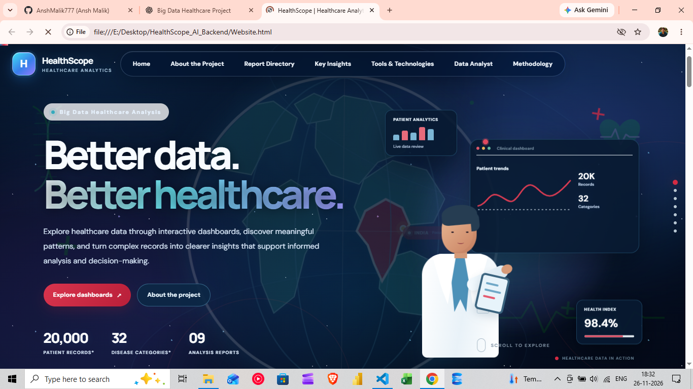
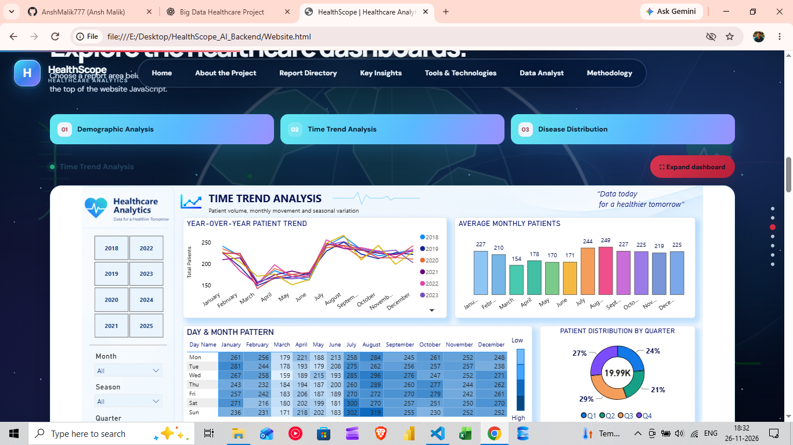
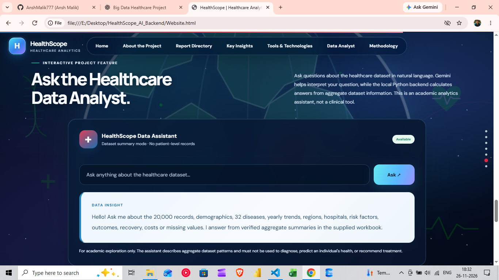
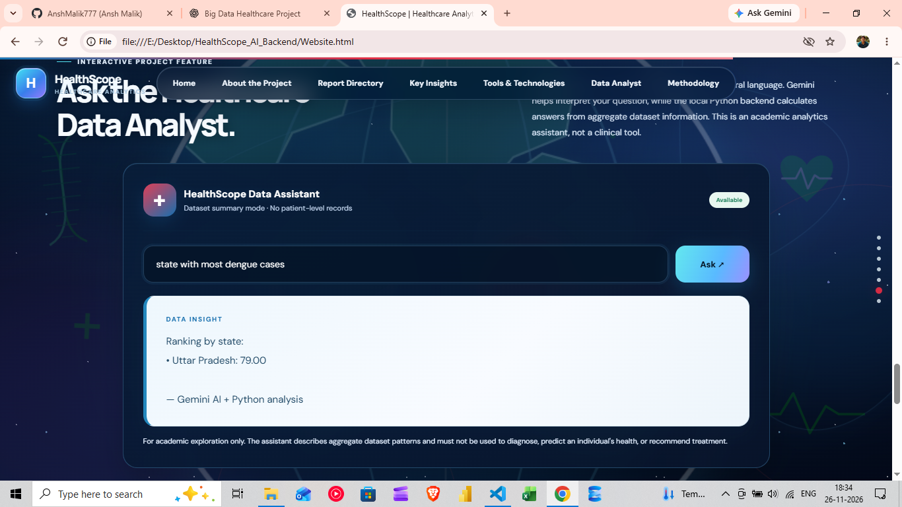
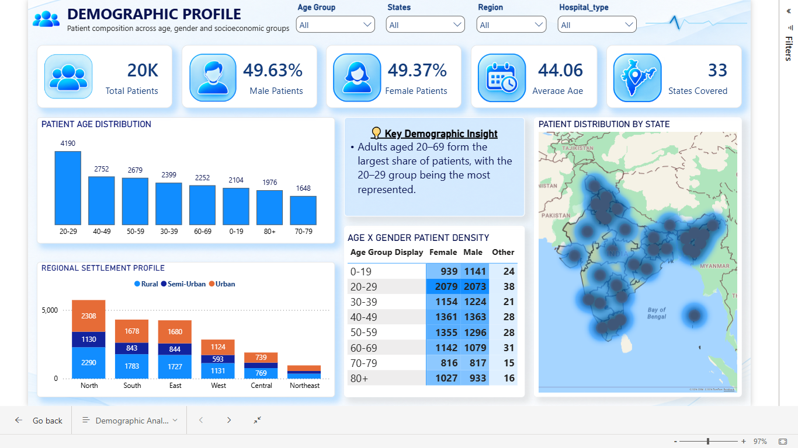
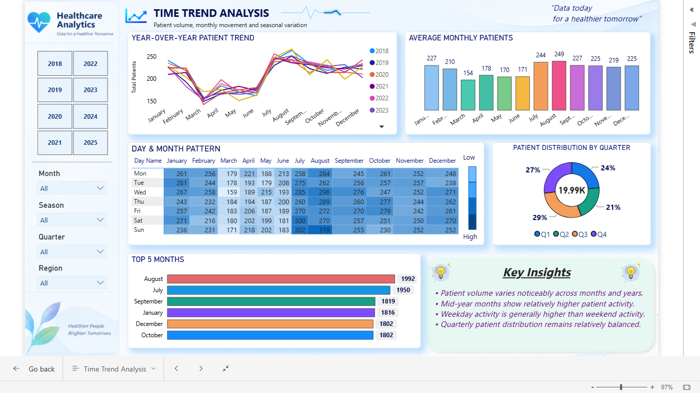
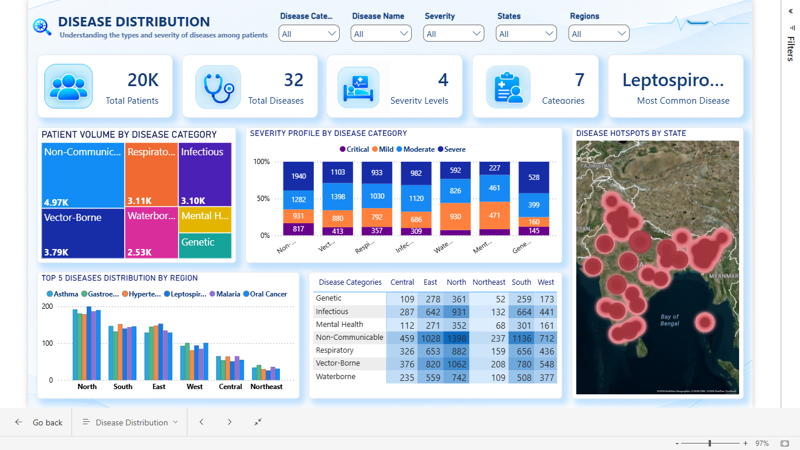
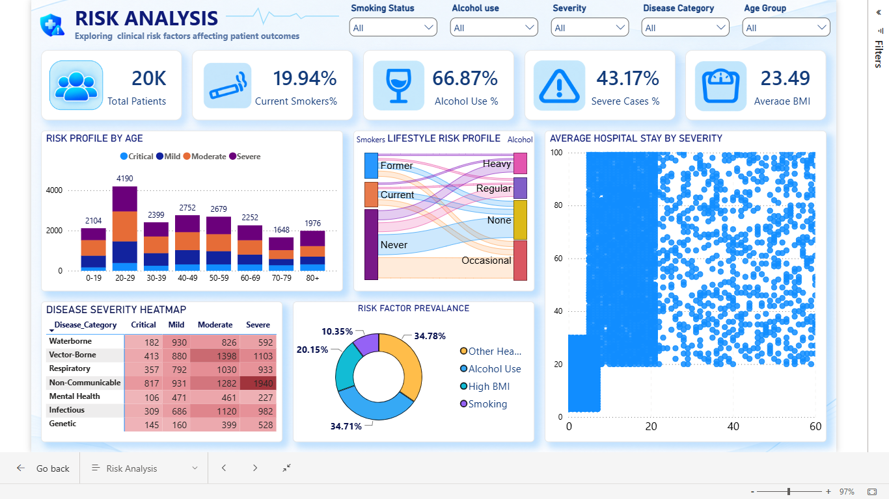
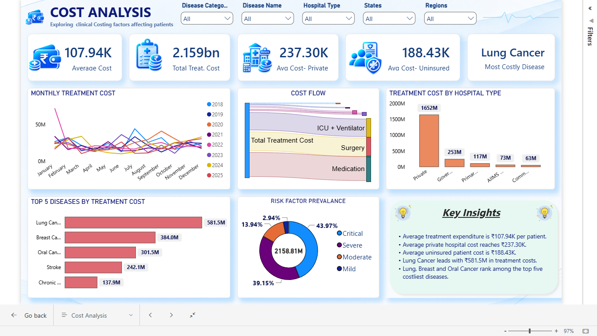

# 🏥 HealthScope – Healthcare Data Analytics & Visualisation

**An interactive healthcare analytics project powered by Python, Google Gemini AI and Microsoft Power BI.**

## 🌐 Explore HealthScope

### 🚀 [OPEN LIVE WEBSITE](https://anshmalik777.github.io/HealthScope/)

**[View GitHub Repository](https://github.com/AnshMalik777/HealthScope)**

---

## 📌 About the Project

HealthScope is a Big Data Healthcare Analysis and Visualisation project developed to explore healthcare patterns, disease distribution, patient demographics, treatment expenditure and hospital insights.

The project combines data analytics, interactive Power BI dashboards and an AI-powered question-answering assistant to make healthcare data easier to explore and understand.
## 📸 Project Screenshots

<table>
  <tr>
    <td align="center">
      
      <br><b>Screenshot 1</b>
    </td>
    <td align="center">
      
      <br><b>Screenshot 2</b>
    </td>
  </tr>
  <tr>
    <td align="center">
      
      <br><b>Screenshot 3</b>
    </td>
    <td align="center">
      
      <br><b>Screenshot 4</b>
    </td>
  </tr>
  <tr>
    <td align="center">
      
      <br><b>Screenshot 5</b>
    </td>
    <td align="center">
      
      <br><b>Screenshot 6</b>
    </td>
  </tr>
  <tr>
    <td align="center">
      
      <br><b>Screenshot 7</b>
    </td>
    <td align="center">
      
      <br><b>Screenshot 8</b>
    </td>
  </tr>
  <tr>
    <td align="center">
      
      <br><b>Screenshot 9</b>
    </td>
    <td align="center">
      
      <br><b>Screenshot 10</b>
    </td>
  </tr>
</table>
## ✨ Key Features

- Interactive healthcare analytics website.
- Six Power BI dashboard sections.
- Gemini AI-powered healthcare question assistant.
- Patient demographic analysis.
- Disease distribution and geographical analysis.
- Healthcare time-trend analysis.
- Risk factor and outcome analysis.
- Treatment cost and hospital insights.

## 📊 Dashboard Modules

| Dashboard | Description |
|---|---|
| Demographic Analysis | Patient distribution by age, gender, state and region |
| Time Trend Analysis | Healthcare trends across months, quarters and years |
| Disease Distribution | Disease frequency and category analysis |
| Risk Analysis | Severity, smoking, alcohol and other risk factors |
| Cost Analysis | Treatment expenditure and cost comparisons |
| Hospital Insights | Hospital types, treatment and recovery patterns |

## 🛠️ Technologies Used

- Python
- Pandas
- Flask
- Google Gemini API
- Microsoft Power BI
- HTML
- CSS
- JavaScript
- GitHub Pages

## 🤖 AI Healthcare Assistant

The HealthScope AI Assistant allows users to ask natural-language questions about healthcare data.

It uses Google Gemini for question interpretation and Python Pandas for data calculations.

The local assistant requires the Python backend, configured Gemini API key and the authorised healthcare dataset to be available.

## 📁 Project Structure

```text
HealthScope/
│
├── api.py
├── app.py
├── analysis_engine.py
├── gemini_engine.py
├── question_engine.py
├── columns.txt
├── requirements.txt
├── index.html
└── .gitignore
```

## ▶️ Run Locally

1. Clone or download this repository.
2. Create a Python virtual environment.
3. Install dependencies:

   `pip install -r requirements.txt`

4. Configure your Gemini API key in a local `.env` file.
5. Place the authorised dataset in the required local `data` folder.
6. Start the Flask backend:

   `python api.py`

7. Open the website using VS Code Live Server.

## 🔐 Data Privacy

API credentials and the local healthcare dataset are not included in this public repository. Use only authorised data and keep API keys private.

## 🎯 Project Objective

To demonstrate the application of big data analytics, healthcare visualisation and AI-assisted data exploration through an interactive web-based platform.

---

### 🌐 Quick Links

- **Live Website:** https://anshmalik777.github.io/HealthScope/
- **GitHub Repository:** https://github.com/AnshMalik777/HealthScope

*HealthScope – Making Healthcare Data Meaningful Through Analytics and AI.*
